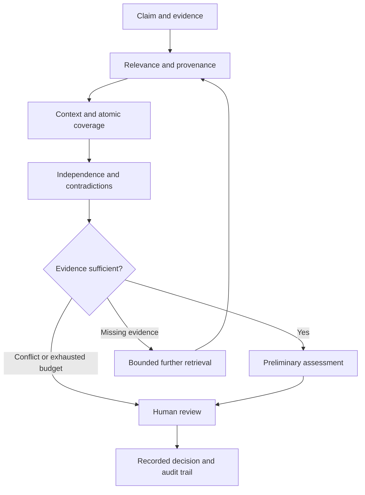

# Evidence AI

**An evidence-first research workspace for the IIM Bangalore CCS project.**

**Streamlit deployment:** use repository `vishnusrivardhangollakaram-boop/2511202_CCS_IIMB`, branch `main`, entry point `streamlit_app.py`, and Python **3.12** in Streamlit Community Cloud. See the [Streamlit deployment guide](docs/STREAMLIT.md). The native Python application runs synthetic and manual investigations without credentials; live providers, verified reviewers and durable PostgreSQL storage are optional configurations. The React/Cloudflare implementation below remains available separately.

[Open the private workspace](https://evidence-ai-ccs-vishnu.playfulmodel2.chatgpt.site) · [Setup](docs/SETUP.md) · [API reference](docs/API.md) · [Verification](docs/VERIFICATION.md)

The hosted workspace requires its owner’s sign-in. Live providers and the real corpus require the configuration described below.

Evidence AI turns a claim and a collection of sources into an inspectable investigation. It shows which parts of the claim are covered, why evidence qualifies or fails, when another search is needed, and when a human should decide. Automatic verdicts remain preliminary; a reviewer decision is a separate recorded action.

**Project:** Agentic Misinformation Detector · **Contributor:** Vishnu Srivardhan Gollakaram · **IIMB roll:** 2511202 · **Brief's demo date:** 26 November 2026.

The principal contribution is **Step 9, Evidence Sufficiency**, connected to **Step 13, Human Review**, with historical retrieval support for **Step 5**. The interface carries forward Student360's visible handoffs and evidence-first reports, and TaleTwinkle's coherent visual design, modular functions, and documented behaviour.

## What you can do

- Investigate a claim in a responsive navy-and-teal workspace.
- Explore explicitly labelled fictional scenarios without provider keys.
- Create cases, inspect source excerpts and claim coverage, and add evidence.
- Review the sufficiency gate's individual checks, missing information and next action.
- Inspect advisory message cues such as forwarding pressure or a request for credentials, with the matched wording visible. These cues do not decide truth or change the gate.
- Use configured live search and model adapters for an actual online investigation.
- Save cases and audit history in PostgreSQL for Streamlit or D1 for the React/Cloudflare app. Streamlit without database configuration uses temporary session storage.
- Perform authorised human review with a reason and a decision record that is append-only through the application API.
- Prepare an authorised historical corpus locally, then import its bounded JSON batches through Method & evaluation with visible progress and cancellation. Source and model verdicts remain separate.
- Export case reports for inspection and use the methodology documentation to plan a defensible evaluation.

There are **no embedded API keys** and **no claim of measured real-world detection accuracy**. The 52,678-article corpus described in the brief is not bundled or automatically loaded. Synthetic cases test workflow behaviour; they are not fact-checks about real events. The sufficiency score is a transparent policy index, not a probability that a claim is true.

## Three operating modes

| Mode | Inputs and evidence | What the result establishes |
| --- | --- | --- |
| Synthetic example | An explicitly selected fictional scenario with fixed evidence and a fixed evaluation clock | Reproducible demonstration of a route and interface; no live research claim |
| Manual investigation | Your claim and submitted evidence | A reviewable case; unsupported or unverified evidence cannot become a fact merely because it was submitted |
| Live investigation | Your claim, configured search/extraction service, and configured model | An actual provider-assisted search, with sources, uncertainty and failures exposed; human validation is still necessary |

A scenario is selected by its explicit ID. Arbitrary claim text is never matched to a canned answer by keyword. Search snippets, article counts, and model scores are not treated as proof.

## Start locally

For the native Streamlit application:

```bash
python3.12 -m venv .venv
source .venv/bin/activate
python -m pip install -r requirements.txt
streamlit run streamlit_app.py
```

On Windows, activate with `.venv\Scripts\Activate.ps1` in PowerShell. Without external storage, Streamlit cases live only in the current browser session; export reports before closing it. See [Streamlit deployment](docs/STREAMLIT.md) for authentication, persistent storage and hosting setup.

For the original React/Cloudflare application:

Use **Node.js 22.13 or newer**, the package manager version recorded in `package.json`, and Python 3.10+ only if using the corpus preparation utility. Preserve the committed lockfile.

```bash
git clone https://github.com/vishnusrivardhangollakaram-boop/2511202_CCS_IIMB.git
cd 2511202_CCS_IIMB
corepack enable
pnpm install --frozen-lockfile
pnpm run build
```

If starting from a supplied source archive, extract it, enter the project directory, and run the same install/build commands; a Git clone is not required.

Apply the committed database migration files in filename order before starting the application. For each unapplied migration:

```bash
node --import ./scripts/sites-env.mjs ./node_modules/wrangler/bin/wrangler.js d1 execute DB --local --config dist/server/wrangler.json --persist-to .wrangler/state --file drizzle/0000_public_chameleon.sql
node --import ./scripts/sites-env.mjs ./node_modules/wrangler/bin/wrangler.js d1 execute DB --local --config dist/server/wrangler.json --persist-to .wrangler/state --file drizzle/0001_corpus_fts.sql
```

Apply any later committed migrations in order as well. Do not replay already applied migration files. Then:

```bash
pnpm run dev
```

The development server prints its local URL. Local development identity is for development only; production routes require the trusted hosting identity boundary. See [setup and deployment](docs/SETUP.md) for database setup, authentication, provider secrets, and the distinction between local and hosted storage.

## Configuration

Secrets stay on the server. Add them to your hosting platform's environment configuration; use ignored local configuration files for development. Do not put credentials in the UI, a URL, a screenshot, source code, or a committed file.

| Variable | Purpose |
| --- | --- |
| `TAVILY_API_KEY` | Live search and source extraction |
| `GEMINI_API_KEY` | Claim/evidence analysis and supported screenshot understanding |
| `GEMINI_MODEL` | Explicit deployment choice of compatible model |
| `REVIEWER_IDS` | Comma-separated stable authenticated user IDs allowed to review real cases |

Live mode reports its availability from server configuration. Missing credentials do not silently activate a simulation. Own synthetic cases can be reviewed without real-case reviewer privileges. An owner can explicitly hand a case to the configured reviewer pool and withdraw that access later. Review permissions are enforced server-side, not by hiding a button.

## How a case moves



The gate evaluates the supplied evidence package. It does not independently establish that every upstream assertion about source quality, stance or provenance is correct. This distinction is part of the design and the evaluation plan.

## Verification

Run the repository's checks before proposing a change:

```bash
pnpm run typecheck
pnpm test
pnpm run build
python3 -m unittest discover -s tests -p 'test_prepare_corpus.py' -v
```

Unit and integration tests establish the behaviour covered by their assertions. They do not establish factual accuracy on unseen news, calibrated confidence, production capacity, or a completed external security audit. See [evaluation](docs/EVALUATION.md) and [release verification](docs/VERIFICATION.md) for the distinction.

## Documentation

| Document | What it covers |
| --- | --- |
| [Streamlit deployment](docs/STREAMLIT.md) | Native Python app, Community Cloud, OIDC, optional PostgreSQL and deployment limitations |
| [Architecture](docs/ARCHITECTURE.md) | Modules, boundaries, storage, state transitions and design decisions |
| [Setup and deployment](docs/SETUP.md) | Local environment, production identity, secrets, migrations and release process |
| [Source delivery](docs/DELIVERY.md) | Repository, source packages, release checks and pilot prerequisites |
| [API reference](docs/API.md) | Contracts, authentication, optimistic concurrency, errors and examples |
| [Data and corpus](docs/DATA.md) | Column mapping, import preparation, provenance, licensing and leakage prevention |
| [Sufficiency policy](docs/SUFFICIENCY.md) | Exact baseline rules, index weights, decision routes and limitations |
| [Message cues](docs/MESSAGE_SIGNALS.md) | Versioned English wording heuristics and why they do not establish falsehood |
| [Reviewer guide](docs/REVIEWER_GUIDE.md) | Evidence checks, decisions, rationale and disagreements |
| [Evaluation plan](docs/EVALUATION.md) | Ground truth, held-out claims, comparisons, metrics and honest reporting |
| [Demo walkthrough](docs/DEMO.md) | Reproducible examples and a credentialed live walkthrough |
| [Operations runbook](docs/OPERATIONS.md) | Monitoring, incident handling, backup, restore, retention and rollback |
| [Security](SECURITY.md) | Threat model, deployment requirements and vulnerability reporting |
| [Contribution guide](CONTRIBUTING.md) | Code standards, tests and pull-request requirements |

## Scope and remaining prerequisites

This repository is a hardened research application and integration foundation. Before an institutional launch, supply the authorised corpus, configure provider accounts and reviewer identities, validate the policy on expert-labelled cases, choose a retention policy, exercise backup/restore, and review capacity and access requirements with the institution.

Audio/video deepfake detection, independent source authentication, model fine-tuning, multilingual validation, external alert dissemination and a managed multi-institution role directory are not demonstrated by this implementation. A corpus field describing an earlier deepfake is not evidence that this application can detect a new deepfake.

The existing [AGPL-3.0 licence](LICENSE) is retained. Source material, data, model weights and provider services retain their own licences and terms. Do not assume a fact-check article's availability grants redistribution rights.
