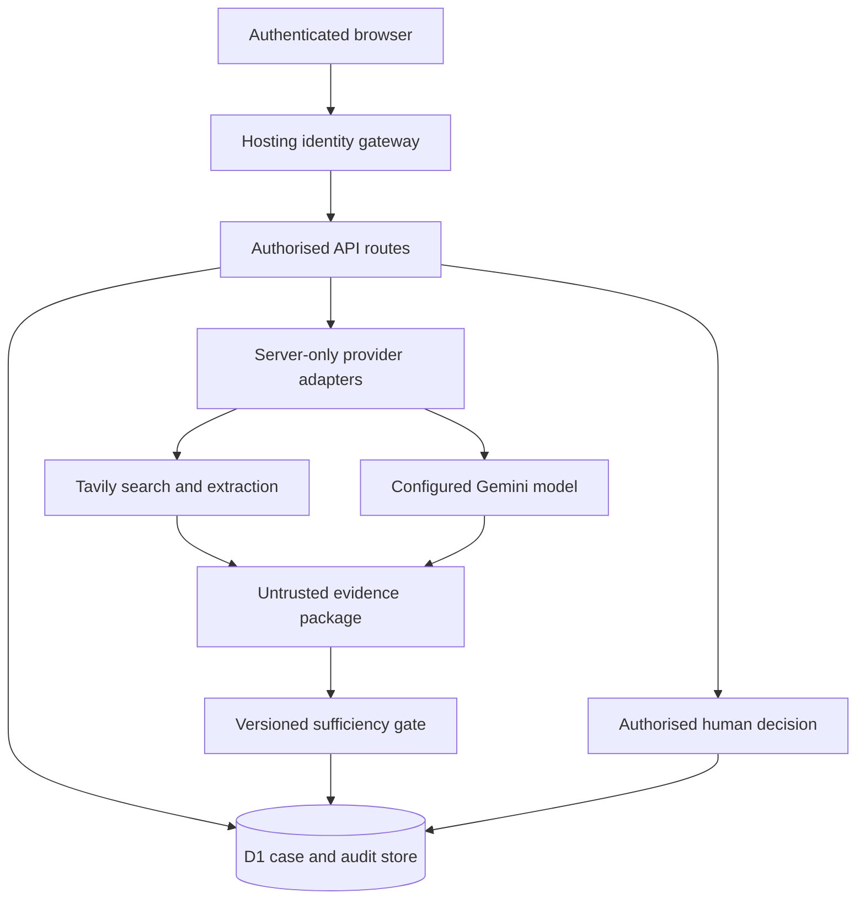

# Architecture and contribution boundaries

## Purpose

The system helps a researcher determine whether the available evidence is adequate to assess a claim. It makes the evidence package and the decision route inspectable. A workflow completion is not a guarantee of truth.

The implementation concentrates on the brief's Step 9 gate and Step 13 human handoff. Step 5 historical matching is available as a corpus retrieval module. The broader brief also proposes multimodal forensics, prioritisation and alerting; these should not be confused with the implemented contribution.

## Components

| Layer | Main source | Responsibility |
| --- | --- | --- |
| Interface | `app/page.tsx`, `components/`, `app/globals.css` | Intake, case library, evidence inspection, review and methodology |
| API boundary | `app/api/`, `lib/http.ts`, `lib/auth.ts` | Authentication, ownership, validation, request limits and safe errors |
| Persistence | `lib/store.ts`, `db/schema.ts`, `drizzle/` | Durable cases, evidence, audit, reviews and corpus records |
| Domain contracts | `lib/domain.ts` | Serializable claim, evidence, gate, verdict and corpus types |
| Policy | `lib/sufficiency.ts` | Deterministic sufficiency checks and preliminary assessment |
| Advisory wording cues | `lib/message-signals.ts` | Versioned English message heuristics, isolated from evidence sufficiency and verdicts |
| Historical retrieval | `lib/retrieval.ts` | Lexical ranking and optional compatible-vector fusion |
| Provider adapters | `lib/providers.ts` | Bounded calls to explicitly configured live services |
| Reproducible examples | `lib/fixtures.ts` | Explicit fictional cases with fixed clocks |
| Corpus preparation | `scripts/prepare_corpus.py` | Validated, audited, bounded import batches; no network upload |
| Corpus import interface | Method & evaluation import panel | Prepared JSON batch preflight, permission acknowledgement, sequential uploads and explicit outcomes |
| Hosting | `worker/`, `vite.config.ts`, `.openai/hosting.json` | Vinext/React application on a Cloudflare Worker, persistent D1 binding |

## Trust boundaries

Browser input, retrieved webpages, search snippets, model output and uploaded image content are untrusted. A source can contain instructions directed at the model; those instructions are data, not authority. The API validates structure and provenance fields before a package can reach the policy.

Identity supplied by the hosting gateway is meaningful only while that gateway strips caller-supplied identity headers and prevents direct origin access. This repository is not a drop-in independent OAuth identity server. A standalone deployment must preserve an equivalent trusted boundary.

## Why the score is not a probability

The gate combines explicit checks into a policy index. Packages with no eligible direct evidence receive zero; otherwise the index represents the weighted checks that passed. It has not been fitted to an empirical probability of truth. A score of 90 must never be described as “90% likely true.” The actual routing decision is based on the required checks and conflict/search-budget conditions, not a single arbitrary confidence threshold.

`VerdictAssessment.preliminary` is always true for automatic assessment. The human review record is distinct and must retain the selected label, rationale, actor and version of the case reviewed.

Message cues are a separate advisory surface. They identify bounded patterns in submitted wording or the extracted claim and show the matched passage. They never feed into source quality, the adequacy index, the gate route or the verdict. A legitimate emergency message can be urgent, and a false claim can contain no listed cue. See [message-signal limitations](MESSAGE_SIGNALS.md).

## Normal case lifecycle

1. An authenticated user creates a case. A client request ID makes a retried create distinguishable from a new submission.
2. The server validates the content and chosen operating mode. Selecting a synthetic example uses its exact scenario ID and marks the case synthetic.
3. Evidence arrives from the fixture, a manual submission or a successful live investigation. Provider failures remain failures; they cannot become a pass or a synthetic fallback.
4. The gate checks relevance, provenance, context/time, atomic claim coverage, source independence and contradictions.
5. `proceed` permits a preliminary assessment. `retrieve_more` identifies gaps for another bounded search. `human_review` records the unresolved issue. A separate reviewer receives access only after explicit owner handoff; a gate route alone does not share private data.
6. An authorised reviewer records a reasoned decision. A stale case version is rejected rather than silently overwriting newer evidence or another decision.
7. The resulting audit trail remains linked to the evidence package and policy version.

## Atomic claims and evidence families

A compound statement must be split into assessable propositions. “A photograph is genuine, was taken in Riverton, and was taken today” contains three propositions. Evidence about one proposition cannot automatically cover the others. Coverage refers to exact entries in `Claim.parts`.

Five reposts of the same article are not five independent sources. The baseline merges matching source-family keys, publishers, canonical URLs and sufficiently similar long excerpts. This is a conservative heuristic, not a complete media-ownership or information-lineage graph. A reviewer should correct family assignments when syndication or a shared original statement is discovered.

## Persistence and concurrency

The D1 database is the system of record; browser storage is not used as a substitute for durable case storage. Cases are scoped to their authenticated owner. An explicit owner handoff grants configured reviewers access through separate review routes; it does not grant general access to the owner's workspace. The owner can withdraw the handoff. Server-generated actor identity must never be replaced by a display name from the request body.

Mutating a case requires its current version. A stale request receives a conflict response and should cause the client to reload the case and preserve its unsent draft for reconciliation. Withdrawing a review handoff increments the case version, so a reviewer working from a previously shared version cannot save after revocation. Data changes and their audit records are batched together where required. Live network calls occur outside the database transaction, so a slow provider does not hold a database transaction open.

The database migration history is append-only after release. Schema changes belong in migrations; production request handlers do not create or alter tables.

Corpus imports are bounded batches. The preparation CLI handles raw authorised CSV/JSONL/Parquet locally; the browser accepts the resulting JSON envelope, not raw corpus ingestion. Cancellation stops future requests and does not undo the current batch. An unconfirmed response is preserved as uncertainty instead of being reported as a failed or successful transaction without evidence.

## Deployment choices

- React and TypeScript share serializable contracts across the UI, routes and policy.
- Small functions isolate retrieval, policy, authentication and storage. A model provider can change without changing the gate contract.
- D1 provides durable server storage suitable for this bounded application. Capacity, geography, retention and multi-institution requirements still need an institutional deployment decision.
- Provider credentials are server-only runtime secrets. They are not placed in client bundles or database evidence records.
- Vinext is an explicit framework dependency recorded in the lockfile. Review its version and release changes before institutional rollout; “production-oriented application” does not imply a warranty for every upstream dependency.

## Deliberate exclusions

There is no automatic claim that a previously fact-checked article settles today's claim; dates, entities and context must still match. There is no automatic conversion of the dataset's `Other` label to `Unverifiable`. There is no hidden sample-data answer for an arbitrary live question. No benchmark winner, factual-accuracy percentage or trained sufficiency model is asserted without an actual evaluation record.
